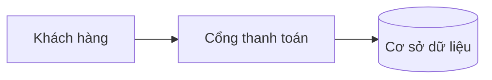
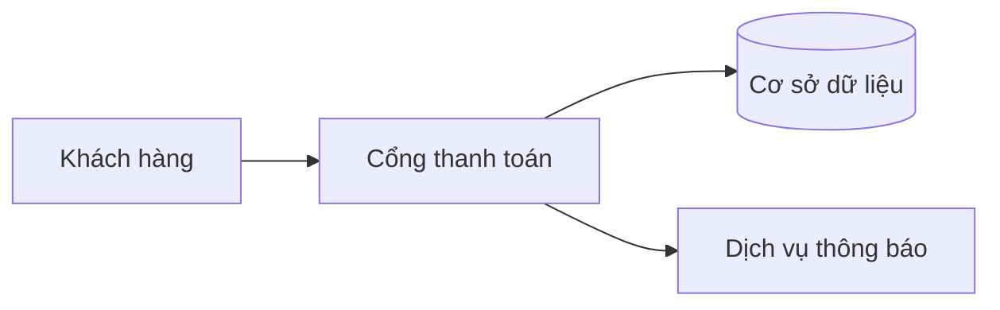

# QUY TẮC VIẾT MARKDOWN CHO TOOL `md2pdf` (MST Software)

> **Dành cho AI.** Bạn đang viết một file `.md` sẽ được tool `md2pdf` chuyển thành PDF có trang bìa, mục lục, đánh số tiêu đề, hộp lưu ý, chú thích hình/bảng. Tool này **tự làm** rất nhiều việc (xem mục 1). Nếu bạn tự làm lại những việc đó trong nội dung, PDF sẽ bị **trùng lặp hoặc lỗi**. Hãy làm đúng từng quy tắc bên dưới. Khi quy tắc nói **BẮT BUỘC** hoặc **CẤM**, không có ngoại lệ.

---

## 1. Tool tự làm — bạn KHÔNG được tự viết

| Tool tự động tạo | CẤM bạn làm |
|---|---|
| Trang bìa (logo, tiêu đề, tác giả, ngày, phiên bản) | Viết trang bìa, dòng "Tác giả/Ngày/Phiên bản" trong nội dung |
| Khung "Thông tin tài liệu" (từ front-matter) | Tự vẽ bảng thông tin tài liệu |
| Mục lục có số trang | Viết mục "Mục lục" hoặc "Table of Contents" |
| Số tiêu đề: `##` → 01, 02; `###` → 2.1; `####` → 2.1.1 | Gõ số vào tiêu đề (`## 1. Giới thiệu`, `## Chương 2`) |
| Số hình, số bảng: "Hình 1.", "Bảng 1." | Gõ chữ "Hình 1", "Bảng 1" vào dòng chú thích |
| Đầu trang (logo + tên tài liệu), chân trang (tên công ty + số trang) | Viết số trang, header, footer |
| Màu sắc, font, khoảng cách, ngắt trang | Dùng HTML/CSS/`<br>`/`<div>`/`style=` để chỉnh giao diện |
| Biểu tượng cho hộp lưu ý | Gõ emoji (⚠️, 💡, ✅…) |

---

## 2. Cấu trúc file (BẮT BUỘC theo thứ tự)

1. **Front-matter** (mục 3) — ở dòng đầu tiên của file.
2. **Một và chỉ một** `# H1`, nội dung **trùng** `title` trong front-matter.
3. Mục `## Tóm tắt` đứng đầu tiên.
4. Các mục `##` chính.
5. Mục `## Kết luận`.
6. Mục `## Tài liệu tham khảo` (chỉ khi có nguồn).

Ngôn ngữ: **tiếng Việt có dấu**, văn phong trang trọng, nhất quán thuật ngữ. Giữ nguyên tiếng Anh với tên riêng, tên sản phẩm, thuật ngữ kỹ thuật phổ biến (API, cache, Laravel…). Viết tắt phải giải thích ở lần dùng đầu tiên: "Cơ sở dữ liệu (CSDL)".

---

## 3. Front-matter

Đặt ở **dòng 1** của file, kẹp giữa hai dòng `---`. Mỗi dòng dạng `khoá: giá trị`, **không** dùng danh sách hay lồng nhau.

| Khoá | Bắt buộc | Ý nghĩa / định dạng |
|---|---|---|
| `title` | **Có** | Tên tài liệu, ≤ 10 từ, không có dấu chấm cuối |
| `subtitle` | Nên có | Một dòng mô tả phạm vi/mục đích, ≤ 15 từ |
| `kicker` | Nên có | Nhãn loại tài liệu trên bìa: `Báo cáo kỹ thuật`, `Đề xuất`, `Hướng dẫn`, `Quy trình`, `Báo cáo phân tích`… |
| `author` | Nên có | Tên người hoặc nhóm tác giả |
| `version` | Nên có | Dạng `1.0`, `1.2`, `2.0` |
| `status` | Nên có | **Chỉ** một trong: `Bản nháp`, `Chính thức`, `Đã duyệt` |
| `reviewer` | Tuỳ chọn | Người duyệt (chức danh hoặc tên) |
| `date` | Nên có | Định dạng `dd/mm/yyyy`, ví dụ `12/11/2026` |
| `toc` | Nên có | `true` khi tài liệu có từ 4 mục `##` trở lên (bật mục lục có số trang); `false` cho tài liệu ngắn |
| `numbering` | Tuỳ chọn | `false` để tắt đánh số tiêu đề |
| `cover` | Tuỳ chọn | `false` để bỏ trang bìa |

Quy tắc giá trị: **không** đặt dấu ngoặc kép trừ khi giá trị chứa dấu hai chấm `:`. Không để trống giá trị (nếu không có thì bỏ nguyên dòng).

Có `version`, `status` hoặc `reviewer` → tool tự thêm khung "Thông tin tài liệu" ngay đầu nội dung.

---

## 4. Tiêu đề

- `#` (H1): **đúng 1 lần**, ngay sau front-matter.
- `##` (H2): mục chính. Một tài liệu thường có **4–9** mục `##`.
- `###` (H3): mục con, dùng khi một mục `##` có từ 2 phần riêng biệt trở lên.
- `####` (H4): chỉ dùng khi thật cần, **tối đa 1 cấp sâu hơn H3**.
- **CẤM** dùng `#####` và `######`.
- **CẤM** nhảy cấp (từ `##` thẳng xuống `####`).
- **CẤM** một mục chỉ có đúng 1 mục con (nếu có `### A` thì phải có ít nhất `### B`).
- Tiêu đề: ≤ 8 từ, danh từ hoặc cụm danh từ, **không** dấu chấm cuối, **không** emoji, **không** in đậm/in nghiêng/mã bên trong, **không** gõ số thứ tự.
- **CẤM** dùng chữ in đậm đứng riêng một dòng thay cho tiêu đề (`**Giá trị khách hàng**`).
- Sau mỗi tiêu đề phải có ít nhất 1 đoạn văn dẫn nhập trước khi có bảng, hình, danh sách hoặc tiêu đề cấp dưới.

---

## 5. Đoạn văn

- Mỗi đoạn 2–5 câu, một ý chính. Cách nhau **đúng một dòng trống**.
- Mỗi đoạn viết trên **một dòng** (không tự xuống dòng giữa câu, không thụt đầu dòng).
- **CẤM** `<br>`, hai dấu cách cuối dòng, hay dấu `\` để ngắt dòng.
- Số: dùng dấu phẩy thập phân, dấu chấm ngăn nghìn: `2,5%`, `1.500 USD`. Luôn có đơn vị, cách số một dấu cách: `480 ms`, `35 USD`.
- Ngày: `dd/mm/yyyy`.
- In đậm `**…**` cho thuật ngữ/kết luận then chốt (không quá ~10% văn bản). In nghiêng `*…*` rất hạn chế (tên tài liệu, từ nước ngoài). **CẤM** gạch chân, **CẤM** viết HOA TOÀN BỘ để nhấn mạnh.

---

## 6. Danh sách

- Gạch đầu dòng dùng `-` (một dấu gạch + một dấu cách). **CẤM** `*` và `+`.
- Danh sách có thứ tự dùng `1.`, `2.`, `3.` (chỉ khi thứ tự có ý nghĩa: các bước, giai đoạn, xếp hạng).
- Tối đa **2 cấp** lồng nhau, thụt lề **2 dấu cách**.
- Các mục song song về ngữ pháp, độ dài tương đương, 3–7 mục mỗi danh sách.
- Không để dòng trống giữa các mục trong cùng danh sách.
- Mẫu mục có nhãn (rất khuyến khích): `- **Mục tiêu:** giảm thời gian phản hồi còn 200 ms.`
- Danh sách việc cần làm dùng `- [ ]` và `- [x]`.

---

## 7. Bảng

Cú pháp bắt buộc: dòng tiêu đề, dòng phân cách, các dòng dữ liệu. **Có dòng trống** trước và sau bảng.

```
| Chỉ số | Hiện tại | Mục tiêu |
|--------|---------:|---------:|
| Thời gian phản hồi | 480 ms | 200 ms |
| Tỷ lệ lỗi | 2,5% | 0,5% |
```

Chú thích bảng (nên có cho mọi bảng): một dòng **ngay sau bảng** (cách bảng một dòng trống), bắt đầu bằng `Bảng:` — tool tự đánh số và đặt chú thích **phía trên** bảng.

```
Bảng: So sánh hiệu năng hiện tại và mục tiêu sau nâng cấp
```

Quy tắc:
- Tối đa **6 cột**, tối đa **10 dòng dữ liệu**. Nhiều hơn → tách thành nhiều bảng.
- Ô ngắn gọn (≤ 20 từ). Văn bản dài phải để thành đoạn văn, không nhét vào ô.
- **Cột số** (chỉ chứa số, có thể kèm đơn vị: `480 ms`, `2,5%`, `35 USD`): dùng dòng phân cách `---:` để căn phải. Tool cũng tự nhận diện cột số.
- Mọi ô trong cùng một cột số dùng **cùng đơn vị** và cùng số chữ số thập phân.
- **Cột mức độ**: chỉ dùng **đúng 3 giá trị** `Cao`, `Trung bình`, `Thấp` (viết hoa chữ đầu, không thêm chữ khác). Tool tô màu tự động (đỏ/vàng/xanh lá). **CẤM** `Rất cao`, `Khá`, `Vừa`, `High`, `Medium`, `Low`, `Cao/Trung bình`.
- Cột đầu tiên là nhãn của dòng (in đậm tự động), không để trống.
- **CẤM** ô trộn (merge), **CẤM** bảng lồng bảng, **CẤM** xuống dòng trong ô, **CẤM** danh sách trong ô, **CẤM** ô trống (ghi `—` nếu không có dữ liệu).
- Khi nhắc tới bảng trong văn bản, viết "Bảng 1", "Bảng 2" **theo đúng thứ tự xuất hiện** của các bảng có chú thích `Bảng:`.

---

## 8. Hình ảnh

Cú pháp bắt buộc — **một dòng riêng**, có dòng trống trước và sau:

```

```

- Phần trong `[ ]` (alt) **chính là chú thích** hiển thị dưới hình, tool tự thêm "Hình N." phía trước. Viết thành **một câu mô tả đầy đủ**, ≤ 20 từ, **không** kết thúc bằng dấu chấm, **không** gõ "Hình 1".
- **BẮT BUỘC** có chú thích (không để `[]` rỗng) trừ khi hình chỉ để trang trí.
- Đường dẫn **tương đối** so với file `.md`, dùng dấu `/`, tên file chữ thường không dấu, không dấu cách: `images/so-do-he-thong.png`.
- Định dạng: `png`, `jpg`, `svg`. Ảnh chụp màn hình dùng `png`.
- **CẤM** thẻ ``, **CẤM** đặt hình cùng dòng với chữ, **CẤM** thuộc tính kích thước. Tool tự co hình vừa khổ giấy (cao tối đa 12 cm).
- Trước mỗi hình nên có câu dẫn: "Hình 2 minh hoạ …". Số hình theo thứ tự xuất hiện của mọi hình có chú thích (ảnh và sơ đồ cộng chung một dãy số).
- Nếu bạn (AI) không có file ảnh thật: **không bịa đường dẫn**. Hãy ghi một dòng `> [!NOTE]` nói rõ cần chèn hình gì, hoặc dùng sơ đồ mermaid nếu mô tả được bằng sơ đồ.

---

## 9. Sơ đồ (mermaid)

Dùng khối mã `mermaid`; ngay dưới (cách một dòng trống) là dòng chú thích bắt đầu bằng `Hình:` — tool tự đánh số "Hình N." và đặt phía dưới sơ đồ.

````


Hình: Luồng xử lý một giao dịch từ khách hàng đến cơ sở dữ liệu
````

Quy tắc:
- Loại sơ đồ nên dùng: `graph LR` (ngang), `graph TD` (dọc), `sequenceDiagram`, `gantt`, `pie`.
- Tối đa **12 nút**. Nhãn nút ≤ 5 từ.
- Nhãn có dấu ngoặc, dấu hai chấm hay ký tự đặc biệt **phải đặt trong ngoặc kép**: `A["Khách hàng (VIP)"]`.
- ID nút là chữ cái không dấu (`A`, `B`, `kho`, `api`); chữ tiếng Việt chỉ nằm trong nhãn.
- **CẤM** khai báo màu/theme/`style`/`classDef`/`%%{init}%%` — tool tự áp màu thương hiệu.
- **CẤM** vẽ sơ đồ bằng ký tự (┌─┐, ├──, →) trong khối mã. Luôn dùng mermaid.
- Mọi sơ đồ phải có chú thích `Hình:`.

---

## 10. Hộp lưu ý (callout)

Cú pháp: dòng đầu là `> [!LOẠI]`, các dòng sau bắt đầu bằng `> `. Đúng **5 loại**, viết HOA:

```
> [!NOTE]
> Nội dung ghi chú.
```

| Loại | Dùng khi | Màu |
|---|---|---|
| `[!NOTE]` | Thông tin bổ sung, giả định, ngữ cảnh | Xanh dương |
| `[!TIP]` | Mẹo, khuyến nghị làm thế nào cho tốt | Xanh lá |
| `[!IMPORTANT]` | Điều bắt buộc phải biết để hiểu/làm đúng | Tím |
| `[!WARNING]` | Rủi ro có thể gây hậu quả, cần cẩn trọng | Vàng |
| `[!CAUTION]` | Nguy hiểm, mất dữ liệu, không thể hoàn tác | Đỏ |

Quy tắc:
- Nội dung ≤ **3 dòng** (≈ 60 từ), không chứa bảng, hình, danh sách dài hay hộp lồng hộp.
- Tối đa **2 hộp mỗi mục `##`**; không đặt hai hộp liền kề nhau.
- **CẤM** gõ tiêu đề hay emoji trong hộp; tool tự thêm biểu tượng và nhãn tiếng Việt ("Ghi chú", "Mẹo", "Quan trọng", "Cảnh báo", "Nguy hiểm").
- Chỉ dùng `>` thường (không có `[!…]`) để **trích dẫn nguyên văn** từ một nguồn; **CẤM** lồng `>>`.

---

## 11. Khối mã

- Dùng ba dấu huyền ``` và **luôn ghi ngôn ngữ**: `bash`, `js`, `ts`, `php`, `python`, `sql`, `json`, `yaml`, `html`, `css`. Không biết ngôn ngữ → dùng `text`.
- Mã `inline` (một dấu huyền) cho tên lệnh, tên file, tên hàm, biến, đường dẫn: `config/app.php`, `php artisan migrate`.
- Khối mã ≤ **25 dòng**; dài hơn thì rút gọn bằng `...` hoặc tách thành nhiều khối kèm câu giải thích.
- Có câu dẫn trước mỗi khối mã (nói khối mã này để làm gì).
- Không dán nhiều lệnh không liên quan vào một khối.

---

## 12. Liên kết

- Dạng `[văn bản mô tả](https://…)`. Văn bản mô tả nói rõ đích đến. **CẤM** "bấm vào đây", "xem tại đây", và **CẤM** dán trần URL giữa đoạn văn (trừ trong danh sách tài liệu tham khảo).
- Liên kết nội bộ tới tiêu đề: `[xem mục Rủi ro](#rui-ro)`. Quy tắc tạo mã neo: viết thường, bỏ dấu tiếng Việt, `đ`→`d`, mọi ký tự không phải chữ/số thành `-`. Ví dụ: "Tóm tắt" → `#tom-tat`; "Chống gian lận và bảo mật" → `#chong-gian-lan-va-bao-mat`. Nếu hai tiêu đề trùng tên, cái thứ hai thêm `-1`.

---

## 13. Tài liệu tham khảo

Mục `## Tài liệu tham khảo` **đặt cuối cùng**. Dùng danh sách có thứ tự, mỗi mục theo mẫu:

```
1. Tên tổ chức/tác giả. *Tên tài liệu*. Năm. URL
```

Trong nội dung, trích dẫn bằng cách nêu rõ tên nguồn hoặc số thứ tự dạng `[1]` ở cuối câu. **CẤM** chú thích cuối trang `[^1]` (tool không bố trí tốt phần này).

---

## 14. Những thứ CẤM tuyệt đối

1. Mọi thẻ HTML (`<br>`, `<div>`, ``, `<table>`, `<span>`, `<style>`, `<center>`…) và CSS nội tuyến.
2. Emoji và ký tự trang trí (✔ ✅ ⚠️ 🔥 → ★) trong tiêu đề, văn bản, bảng. (Dấu `–` và `—` được phép.)
3. Hai dòng `---` ngoài front-matter để kẻ ngang cho đẹp. Chỉ dùng `---` khi thực sự cần ngăn hai phần hoàn toàn khác nhau, rất hiếm.
4. Thêm mục "Mục lục", "Trang bìa", "Lịch sử phiên bản" tự vẽ, "Cảm ơn", "Liên hệ" trừ khi người dùng yêu cầu.
5. Công thức toán (`$…$`, LaTeX) — tool **chưa hỗ trợ**; diễn đạt bằng chữ hoặc bảng.
6. Dòng trống thừa (nhiều hơn 1 dòng trống liên tiếp), dấu cách thừa cuối dòng, ký tự Tab.
7. Lặp lại nguyên văn tiêu đề ở đầu đoạn đầu tiên ("Phần này nói về …").
8. Bịa số liệu, đường dẫn ảnh, URL, tên người, tên nguồn. Không biết thì nói thẳng là chưa có dữ liệu bằng hộp `> [!NOTE]`.

---

## 15. Độ dài & cách trình bày nội dung

- Tài liệu thường dài **3–15 trang PDF**. Một mục `##` chiếm khoảng **½–2 trang**.
- Ưu tiên **bảng** để so sánh ≥ 3 đối tượng theo ≥ 2 tiêu chí; ưu tiên **sơ đồ** để mô tả luồng, kiến trúc, quan hệ; ưu tiên **danh sách** cho các bước/ý song song; còn lại là đoạn văn.
- Không để quá ~2 trang liên tiếp chỉ có chữ: chèn bảng, sơ đồ hoặc hộp lưu ý khi phù hợp.
- Mục `## Tóm tắt`: 1 đoạn 2–4 câu nêu kết luận chính, theo sau là 3–5 gạch đầu dòng có nhãn (`**Mục tiêu:**`, `**Phạm vi:**`, `**Kết quả:**`, `**Thời gian:**`…).
- Mục `## Kết luận`: nêu lại kết luận, quyết định cần đưa ra và bước tiếp theo, ≤ 1 đoạn + 1 danh sách ngắn.
- Mọi bảng, hình, sơ đồ phải được **nhắc tới trong văn bản** ít nhất một lần.

---

## 16. Mẫu chuẩn (sao chép cấu trúc này)

Đây là file mẫu đã chạy thành công qua tool. Giữ nguyên cú pháp, chỉ thay nội dung.

````markdown
---
title: Tên tài liệu ngắn gọn, rõ nghĩa
subtitle: Một dòng mô tả phạm vi hoặc mục đích
kicker: Báo cáo kỹ thuật
author: Nhóm Kỹ thuật MST
version: 1.0
status: Bản nháp
reviewer: Trưởng phòng Công nghệ
date: 12/11/2026
toc: true
---

# Tên tài liệu ngắn gọn, rõ nghĩa

## Tóm tắt

Tài liệu này đánh giá hiện trạng hệ thống và đề xuất lộ trình cải thiện trong 12 tuần. Kết luận chính: hệ thống đủ điều kiện nâng cấp, cần ưu tiên xử lý rủi ro mất dữ liệu.

- **Mục tiêu:** giảm thời gian phản hồi từ 480 ms xuống 200 ms.
- **Phạm vi:** cổng thanh toán và cơ sở dữ liệu giao dịch.
- **Thời gian:** 12 tuần, 3 giai đoạn.

> [!NOTE]
> Số liệu lấy từ môi trường thử nghiệm, chưa phải số liệu vận hành thật.

## Hiện trạng

Hệ thống gồm ba thành phần chính, giao tiếp với nhau qua API.

### Kiến trúc

Luồng xử lý một giao dịch được mô tả ở sơ đồ dưới đây.



Hình: Luồng xử lý một giao dịch từ khách hàng đến cơ sở dữ liệu

### Hiệu năng

Bảng 1 so sánh hiệu năng hiện tại với mục tiêu sau nâng cấp.

| Chỉ số | Hiện tại | Mục tiêu |
|--------|---------:|---------:|
| Thời gian phản hồi | 480 ms | 200 ms |
| Tỷ lệ lỗi | 2,5% | 0,5% |
| Giao dịch mỗi giây | 120 | 400 |

Bảng: So sánh hiệu năng hiện tại và mục tiêu sau nâng cấp

## Rủi ro

> [!WARNING]
> Hiện chưa có cơ chế sao lưu tự động cho dữ liệu giao dịch.

| Rủi ro | Mức | Cách giảm |
|--------|-----|-----------|
| Mất dữ liệu giao dịch | Cao | Sao lưu hằng giờ, kiểm tra khôi phục định kỳ |
| Quá tải giờ cao điểm | Trung bình | Thêm bộ nhớ đệm và giới hạn tốc độ |
| Chi phí hạ tầng tăng | Thấp | Đàm phán lại hợp đồng với nhà cung cấp |

Bảng: Các rủi ro chính và cách giảm thiểu

## Lộ trình

1. **Tuần 1–4:** thiết lập sao lưu và giám sát.
2. **Tuần 5–8:** tối ưu truy vấn, bổ sung bộ nhớ đệm.
3. **Tuần 9–12:** kiểm thử tải và bàn giao.

### Cấu hình sao lưu

Lệnh dưới đây tạo bản sao lưu mỗi giờ.

```bash
0 * * * * /usr/local/bin/backup.sh --target db --keep 48
```

> [!TIP]
> Chạy thử khôi phục trên máy kiểm thử trước khi bật sao lưu thật.

## Kết luận

Hệ thống đủ điều kiện nâng cấp. Cần ưu tiên xử lý rủi ro mất dữ liệu trước, sau đó mới tối ưu hiệu năng. Chi tiết kỹ thuật xem tại [tài liệu của nhà cung cấp](https://example.com/docs).

## Tài liệu tham khảo

1. Nhà cung cấp dịch vụ. *Hướng dẫn sao lưu và khôi phục*. 2026. https://example.com/docs
2. Nhóm Kỹ thuật MST. *Báo cáo kiểm thử tải nội bộ*. 2026.
````

---

## 17. Danh sách tự kiểm tra trước khi trả file

Đối chiếu **từng dòng** trước khi giao kết quả:

- [ ] Dòng 1 là `---`; front-matter có `title`; `status` là một trong 3 giá trị cho phép; `date` dạng `dd/mm/yyyy`.
- [ ] Có đúng **1** `# H1`, trùng `title`.
- [ ] Mục đầu tiên là `## Tóm tắt`; mục cuối là `## Tài liệu tham khảo` hoặc `## Kết luận`.
- [ ] Không có số thứ tự trong tiêu đề; không có `#####`; không nhảy cấp; không có mục con đơn lẻ.
- [ ] Không có mục "Mục lục", không có dòng Tác giả/Ngày/Phiên bản trong nội dung.
- [ ] Mọi bảng: có dòng phân cách, ≤ 6 cột, cột số có `---:`, cột mức độ chỉ có `Cao`/`Trung bình`/`Thấp`, có dòng `Bảng: …` ngay sau (cách 1 dòng trống).
- [ ] Mọi hình: một dòng riêng, alt là chú thích đầy đủ, đường dẫn tương đối, không bịa file.
- [ ] Mọi sơ đồ mermaid: ≤ 12 nút, nhãn đặc biệt có ngoặc kép, có dòng `Hình: …` ngay dưới.
- [ ] Hộp lưu ý chỉ dùng `NOTE`, `TIP`, `IMPORTANT`, `WARNING`, `CAUTION`; ≤ 3 dòng; ≤ 2 hộp mỗi mục.
- [ ] Mọi khối mã có ghi ngôn ngữ.
- [ ] Không có HTML, emoji, `[^1]`, `---` thừa, công thức toán, dòng trống thừa.
- [ ] Mọi bảng/hình/sơ đồ đều được nhắc trong văn bản; số "Hình N"/"Bảng N" trong văn bản khớp thứ tự xuất hiện.
- [ ] Không có số liệu, URL, đường dẫn bịa đặt.

---

## 18. Dành cho người dùng — cách chạy

```powershell
node src/md2pdf.js ten-file.md
```

Tuỳ chọn thêm: `--author "Tên"`, `--subtitle "…"`, `--kicker "…"`, `--no-cover`, `--no-numbering`, `--no-page-numbers`, `--format Letter`. Tham số dòng lệnh **ghi đè** giá trị trong front-matter.
