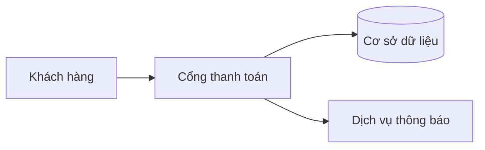

# Tên tài liệu ngắn gọn, rõ nghĩa

## Tóm tắt

Tài liệu này đánh giá hiện trạng hệ thống và đề xuất lộ trình cải thiện trong 12 tuần. Kết luận chính: hệ thống đủ điều kiện nâng cấp, cần ưu tiên xử lý rủi ro mất dữ liệu.

- **Mục tiêu:** giảm thời gian phản hồi từ 480 ms xuống 200 ms.
- **Phạm vi:** cổng thanh toán và cơ sở dữ liệu giao dịch.
- **Thời gian:** 12 tuần, 3 giai đoạn.

> [!NOTE]
> Số liệu lấy từ môi trường thử nghiệm, chưa phải số liệu vận hành thật.

## Hiện trạng

Hệ thống gồm ba thành phần chính, giao tiếp với nhau qua API.

### Kiến trúc

Luồng xử lý một giao dịch được mô tả ở sơ đồ dưới đây.



Hình: Luồng xử lý một giao dịch từ khách hàng đến cơ sở dữ liệu

### Hiệu năng

Bảng 1 so sánh hiệu năng hiện tại với mục tiêu sau nâng cấp.

| Chỉ số | Hiện tại | Mục tiêu |
|--------|---------:|---------:|
| Thời gian phản hồi | 480 ms | 200 ms |
| Tỷ lệ lỗi | 2,5% | 0,5% |
| Giao dịch mỗi giây | 120 | 400 |

Bảng: So sánh hiệu năng hiện tại và mục tiêu sau nâng cấp

## Rủi ro

> [!WARNING]
> Hiện chưa có cơ chế sao lưu tự động cho dữ liệu giao dịch.

| Rủi ro | Mức | Cách giảm |
|--------|-----|-----------|
| Mất dữ liệu giao dịch | Cao | Sao lưu hằng giờ, kiểm tra khôi phục định kỳ |
| Quá tải giờ cao điểm | Trung bình | Thêm bộ nhớ đệm và giới hạn tốc độ |
| Chi phí hạ tầng tăng | Thấp | Đàm phán lại hợp đồng với nhà cung cấp |

Bảng: Các rủi ro chính và cách giảm thiểu

## Lộ trình

1. **Tuần 1–4:** thiết lập sao lưu và giám sát.
2. **Tuần 5–8:** tối ưu truy vấn, bổ sung bộ nhớ đệm.
3. **Tuần 9–12:** kiểm thử tải và bàn giao.

### Cấu hình sao lưu

Lệnh dưới đây tạo bản sao lưu mỗi giờ.

```bash
0 * * * * /usr/local/bin/backup.sh --target db --keep 48
```

> [!TIP]
> Chạy thử khôi phục trên máy kiểm thử trước khi bật sao lưu thật.

## Kết luận

Hệ thống đủ điều kiện nâng cấp. Cần ưu tiên xử lý rủi ro mất dữ liệu trước, sau đó mới tối ưu hiệu năng. Chi tiết kỹ thuật xem tại [tài liệu của nhà cung cấp](https://example.com/docs).

## Tài liệu tham khảo

1. Nhà cung cấp dịch vụ. *Hướng dẫn sao lưu và khôi phục*. 2026. https://example.com/docs
2. Nhóm Kỹ thuật MST. *Báo cáo kiểm thử tải nội bộ*. 2026.
