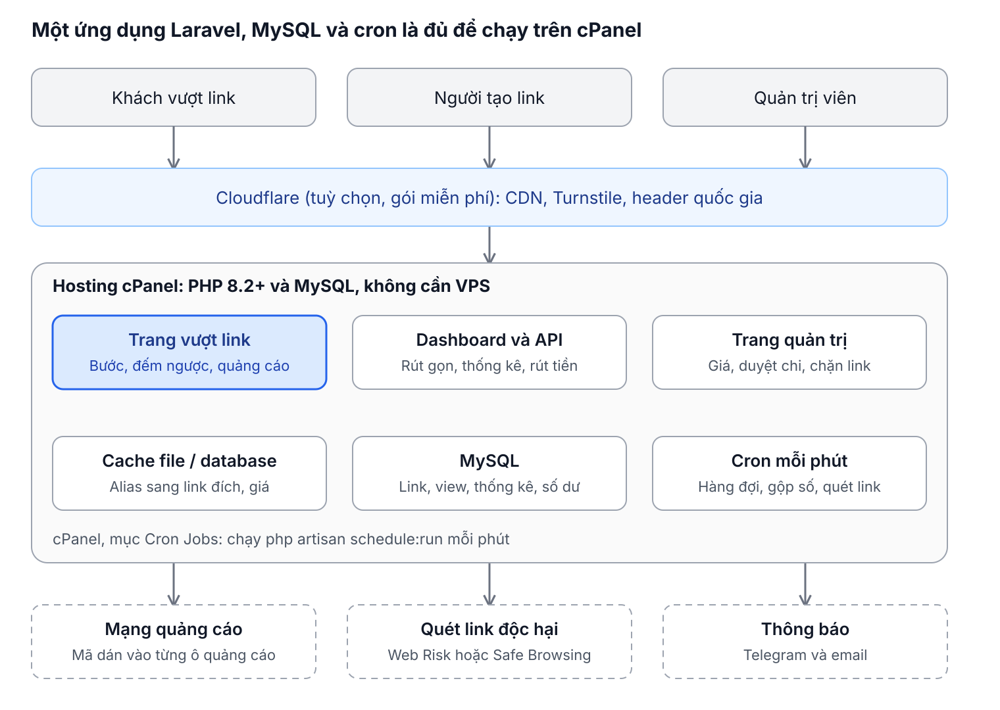
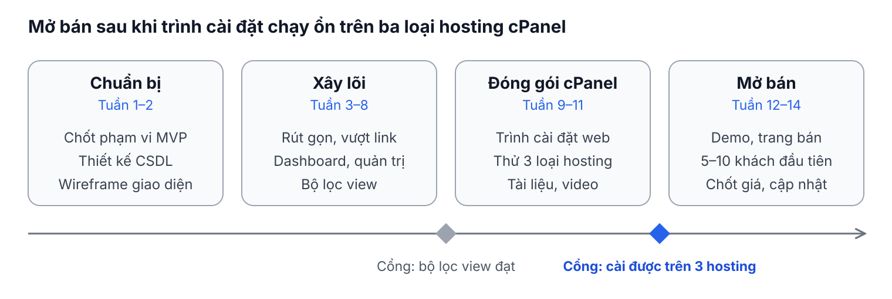

# Dự án rút gọn link kiếm tiền

Ngày 12/11/2026

## Tóm tắt

Dự án xây một bộ mã nguồn website rút gọn link kiếm tiền bằng Laravel, cài được trên hosting cPanel thông thường, rồi bán license cho những người muốn tự mở trang kiểu link4m hay shrinkme. Người bán chỉ làm và bán source; người mua tự vận hành, nhận tiền từ mạng quảng cáo và trả tiền cho người tạo link.

- **Sản phẩm:** một file zip gồm mã nguồn, trình cài đặt trên web, trang quản trị, tài liệu và video hướng dẫn; không cần VPS, Redis hay SSH.
- **Khách hàng:** người làm MMO, chủ nhóm / kênh có traffic muốn có trang rút gọn link riêng, và người muốn kinh doanh dịch vụ rút gọn link.
- **Điểm khác biệt:** giao diện và tài liệu tiếng Việt, thanh toán nội địa (chuyển khoản ngân hàng, MoMo, USDT BEP20, thẻ cào), chạy mượt trên hosting cPanel giá rẻ, bộ lọc view chống gian lận có sẵn.
- **Thời gian:** khoảng 12–14 tuần với 2–3 người để có bản đầu bán được; doanh thu đến từ phí license, dịch vụ cài đặt, theme, plugin và gia hạn cập nhật.

## Các website tham khảo

Thị trường Việt Nam đang chạy hai kiểu: trang nhiệm vụ nhiều bước (giá tính theo đồng / view) và Direct qua trang quảng cáo (giá tính theo USD / 1.000 view). Bảng dưới lấy từ [tổng hợp của Blog DTA](https://blogdta.com/top-10-website-rut-gon-link-kiem-tien-uy-tin-hieu-qua-o-viet-nam-current_date-formatm-y/) (cập nhật 20/10/2026) và [trang giá của ShrinkMe](https://shrinkme.io/payout-rates); mức trả do từng trang tự quy định và thay đổi theo thời điểm.

| Website | Kiểu | Thanh toán | Rút tối thiểu | Điều đáng học theo |
| --- | --- | --- | --- | --- |
| Link4M | Nhiệm vụ | MoMo, ngân hàng, PayPal | 35 USD | Tài khoản mới được duyệt nguồn traffic và thanh toán trong 30 ngày; các lệnh sau trả không quá 12 ngày; khuyến mãi mức trả theo mùa |
| Phiên Chợ Số | Nhiệm vụ | USDT BEP20, ngân hàng, thẻ cào (Viettel, Mobifone, Vinaphone, Garena) | 5 USD hoặc 50.000 đ | Duyệt rút 5–7 ngày; cấm nguồn 18+, cờ bạc |
| XTASK | Nhiệm vụ, Direct | USDT BEP20, ngân hàng, MoMo | 5 USD hoặc 100.000 đ | Duyệt rút trong 1–4 giờ; giá tách theo số bước (1 bước 500 đ, 2 bước 600 đ, không code 400 đ / view) |
| TrafficVN, Traffic4K, VietUser | Nhiệm vụ, Direct | USDT BEP20 | 265.000 đ (VietUser 10 USD) | Giá tách theo nguồn (Google Search, trực tiếp, mạng xã hội) 400–500 đ / view; trả trong 24–48 giờ |
| Site2S | Nhiệm vụ, Direct | MoMo, ngân hàng | 5 USD | Google Search 20 USD, Direct 4 USD / 1.000 view; admin duyệt nguồn qua Telegram trước khi nhận người tạo link; rút tối đa 7 ngày làm việc |
| ShortDL | Direct | MoMo, ngân hàng, PayPal, USDT | 5 USD | 7 USD / 1.000 view tại Việt Nam |
| DropLink | Direct | MoMo, ngân hàng, PayPal | 2–10 USD | 7 USD / 1.000 view tại Việt Nam |
| LinkForEarn | Direct nhiều cấp | Ngân hàng VN, MoMo, FaucetPay | 0,1 USD | Người tạo link tự chọn cấp Direct khi rút gọn, mỗi cấp một mức giá (cấp 03: 21 USD, cấp 08: 1 USD / 1.000 view) |
| ShrinkMe | Direct quảng cáo | PayPal, Paytm, UPI | 5 USD | Thưởng đăng ký 1 USD, trả hằng ngày, 20% hoa hồng giới thiệu trọn đời, bảng giá theo quốc gia và thiết bị, có API |

Các tên khác cùng thị trường: Link1s, 123link, Bom.so, Mmo1s, Megaurl, Traffic68, LINKTOP.ONE.

ShrinkMe cũng công bố điều kiện để một view được tính: khách duy nhất trong 24 giờ, ở lại trang ít nhất 10 giây, bật JavaScript và cookie, và đi tới trang đích. Bộ source nên dùng chính bộ điều kiện này làm mặc định và cho quản trị viên chỉnh từng thông số.

## Các bộ source đang bán và điều cần học

Trên CodeCanyon đã có nhiều script rút gọn link bán theo license, và hai trong số đó chạy được trên cPanel; chỗ còn trống cho bản tiếng Việt là mô hình trả tiền cho người tạo link kèm thanh toán nội địa.

| Bộ source | Công nghệ | Giá / doanh số | Điều đáng học |
| --- | --- | --- | --- |
| [phpShort](https://codecanyon.net/category/php-scripts/miscellaneous?term=stats) | Laravel, PHP 8.x, MySQL | 59 USD, 969 lượt bán, cập nhật 01/07/2026 | Cho thấy nhu cầu mua source Laravel vẫn lớn và cần cập nhật đều |
| [Premium URL Shortener](https://gempixel.com/docs/premium-url-shortener) (GemPixel) | PHP 8.2+, MySQL 5.7–8.2 / MariaDB | Giấy phép Regular và Extended | Bộ tính năng đầy đủ nhất: trình cài đặt web, tự cập nhật bằng mã mua hàng, trang Cron Jobs trong admin, theme con, dịch ngôn ngữ ngay trong admin, vai trò và phân quyền, plugin cổng thanh toán |
| [LteUrl](https://codecanyon.net/item/lteurl-link-shortener-reactjs-nodejs/50989338) | Laravel, Inertia.js, React, PHP 8.2+, MySQL | 25 lượt bán | Ghi rõ chạy được trên cPanel shared hosting và có dịch vụ cài đặt kèm; tính năng chụp màn hình trang đích phụ thuộc NodeJS nên không chạy trên cPanel |
| [Shortny](https://codecanyon.net/category/php-scripts/miscellaneous?term=stats) | PHP 7.x, MySQL 5.x | 29 USD, 381 lượt bán, cập nhật 01/2021 | Script cũ vẫn có người mua: giá thấp và dễ cài |

Trong phần tài liệu đã đọc, các bộ trên thiên về công cụ rút gọn và quản lý link thương hiệu; mình không thấy mô hình chia tiền theo 1.000 view cho người tạo link kèm bảng giá theo quốc gia. Đây là khoảng trống của bản tiếng Việt.

**Những điều nên học theo cho bản source của bạn**

- Trình cài đặt trên web: kiểm tra phiên bản PHP và extension, nhập thông tin MySQL, tạo tài khoản admin, hiện hướng dẫn thêm cron.
- Tự cập nhật bằng mã mua hàng cùng changelog rõ ràng; đây là lý do để khách gia hạn.
- Trang Cron Jobs trong admin liệt kê sẵn từng lệnh để dán vào cPanel.
- Dịch ngôn ngữ và theme con ngay trong admin để khách tùy biến mà không mất khi cập nhật.
- Vai trò và phân quyền cho nhân viên của người mua (duyệt rút tiền, kiểm duyệt link).
- Cổng thanh toán và tính năng phụ làm dạng plugin, bán riêng.
- Quét link độc hại bằng Google Web Risk hoặc Safe Browsing, thêm danh sách chặn từ khóa và tên miền. Tài liệu GemPixel ghi Web Risk bắt buộc có tài khoản thanh toán khi dùng thương mại.
- Hai hạng giấy phép: Regular (một trang không thu phí người dùng cuối) và Extended (dịch vụ có thu phí).

## Mô hình kinh doanh làm và bán source

Doanh thu của bạn đến từ bán license, dịch vụ cài đặt và gia hạn cập nhật; không phát sinh chi phí quảng cáo, máy chủ vận hành hay quỹ trả tiền người dùng, vì phần đó thuộc về người mua.

| Gói | Nội dung | Giá đề xuất (giả định) |
| --- | --- | --- |
| Starter | Mã nguồn, 1 tên miền, tài liệu và video cài đặt, cập nhật 6 tháng | 2–3 triệu đ |
| Pro | Starter + cài đặt giúp lên hosting của khách, 1 theme riêng, cập nhật và hỗ trợ 12 tháng | 4–5 triệu đ |
| Business | Pro + nhiều tên miền, đổi giao diện theo thương hiệu, tích hợp cổng thanh toán riêng, hỗ trợ ưu tiên | 8–10 triệu đ |
| Gia hạn cập nhật | Bản vá bảo mật, tính năng mới, hỗ trợ | khoảng 30% giá gói mỗi năm |
| Dịch vụ lẻ | Cài đặt trên hosting cPanel, chuyển hosting, theme, plugin cổng thanh toán | 300–500 nghìn đ mỗi lần cài (theme và plugin báo giá riêng) |

Giá trên là giả định khởi điểm, đặt cạnh mức 25–59 USD của các script quốc tế ở phần trước; nên bán thử cho 5–10 khách đầu để chốt giá.

**Giá trị khách mua nhận được**

Công thức lợi nhuận của người vận hành: số view hợp lệ × (doanh thu quảng cáo trên 1.000 view − mức trả cho người tạo link) − hosting − chi phí khác. Ví dụ minh họa với 1 triệu view hợp lệ mỗi tháng: doanh thu quảng cáo 4 USD / 1.000 view là 4.000 USD, trả người tạo link 2,5 USD / 1.000 view là 2.500 USD, còn khoảng 1.500 USD trước chi phí hosting và nhân sự. Đây là con số giả định để giải thích cách tính; tài liệu bán hàng nên trình bày công thức và để khách tự điền số của họ, không đưa ra cam kết thu nhập.

**Nguồn thu phụ**

- Theme giao diện và bộ trang vượt link mẫu bán riêng.
- Plugin: cổng thanh toán, thông báo Telegram, tích hợp thêm mạng quảng cáo.
- Nhận làm tùy biến theo yêu cầu cho gói Business.

## Tính năng của bộ source

Bộ source có ba mặt: trang vượt link cho khách, bảng điều khiển cho người tạo link, và trang quản trị cho người mua source; bản đầu cần đủ cả ba và mọi thông số chỉnh được từ trang quản trị.

| Khu vực | Bản đầu (MVP) | Bản mở rộng |
| --- | --- | --- |
| Trang vượt link | Direct 1–3 bước, đếm ngược, ô dán mã quảng cáo cho từng vị trí, xác minh Turnstile / hCaptcha ở bước cuối, bước xem trang đối tác trong N giây | Nhiều mẫu giao diện, chọn số bước theo quốc gia hoặc thiết bị, bước nhiệm vụ tùy chỉnh |
| Người tạo link | Đăng ký, rút gọn một link, alias tùy chỉnh, chọn cấp (số bước) khi rút gọn, thống kê view và thu nhập theo ngày, link giới thiệu, yêu cầu rút tiền | API, rút gọn hàng loạt, script thay link trên toàn trang web, tên miền riêng, 2FA |
| Bảng giá | Giá trên 1.000 view theo quốc gia, thiết bị và cấp; thưởng đăng ký; hoa hồng giới thiệu theo phần trăm | Khuyến mãi theo thời gian, giá riêng cho từng người dùng, bảng giá công khai tự cập nhật |
| Thanh toán cho người tạo link | Ngưỡng rút tối thiểu, ngày chờ duyệt, duyệt tay trong admin, xuất file CSV lệnh chi; phương thức: ngân hàng, MoMo, USDT BEP20, thẻ cào, PayPal | Hiển thị mã VietQR cho lệnh chi, thông báo qua Telegram và email, lịch trả cố định hằng tuần |
| Quản trị | Duyệt người dùng và nguồn traffic của tài khoản mới, quản lý link, khóa link vi phạm, danh sách chặn từ khóa và tên miền, cấu hình mạng quảng cáo, nhật ký gian lận | Vai trò và phân quyền, báo cáo doanh thu – chi phí, tự cập nhật bằng mã mua hàng, plugin |
| Nội dung và tuân thủ | Điều khoản, danh mục bị cấm (18+, cờ bạc), nút báo cáo vi phạm / DMCA, thông báo hệ thống | Đa ngôn ngữ chỉnh trong admin, trang blog và FAQ |

Nguyên tắc cho trang vượt link: tổng thời gian chờ ở mức vừa phải, nút "Tiếp tục" rõ ràng, quảng cáo đặt đúng vị trí quảng cáo, không giả làm nút bấm. Trang dễ dùng giữ tỷ lệ hoàn thành cao, và đó cũng là điều người mua source quan tâm.

## Kiến trúc Laravel trên cPanel

Toàn bộ hệ thống là một ứng dụng Laravel dùng MySQL, cache dạng file hoặc database và cron của cPanel; không cần Redis, VPS hay dịch vụ chạy nền, nên người mua chỉ cần một gói hosting thông thường.

| Thành phần | Lựa chọn | Lý do |
| --- | --- | --- |
| Backend | Laravel bản ổn định mới nhất hỗ trợ PHP 8.2+ | Đúng yêu cầu dự án; PHP 8.2+ cũng là mức yêu cầu của các script cùng loại |
| Giao diện | Blade, Alpine.js, Tailwind, build sẵn thành file tĩnh trong public | Người mua không cần cài Node |
| Cơ sở dữ liệu | MySQL 5.7+ hoặc MariaDB | Có sẵn trên mọi hosting cPanel |
| Cache | Driver file hoặc database | Lưu bản đồ alias sang link đích và bảng giá; bật route cache và config cache khi triển khai |
| Hàng đợi | Driver database, cron chạy `schedule:run` mỗi phút, trong đó có `queue:work --stop-when-empty` | Thay cho tiến trình nền mà hosting chia sẻ không cho chạy lâu |
| Ghi view | Ghi theo lô, gộp thống kê theo ngày bằng cron, dọn view thô sau 30–90 ngày | Giữ bảng view nhỏ để hosting chạy nhanh |
| Đóng gói | File zip có sẵn thư mục vendor; file .htaccess ở gốc trỏ vào thư mục public khi không đổi được document root | Không cần Composer hay SSH |
| Cài đặt | Trình cài đặt web kiểm tra PHP và extension (openssl, curl, mbstring, pdo_mysql, xml, zip, gd, iconv), quyền ghi storage, tạo .env, chạy migrate, tạo admin, hiện lệnh cron cần thêm | Cài xong trong vài phút, người không chuyên vẫn làm được |

Các bảng dữ liệu chính: `users`, `links`, `views`, `daily_stats`, `cpm_rates`, `withdrawals`, `referrals`, `ad_slots`, `fraud_flags`, `settings`.

## Chống gian lận và bảo mật

Bộ lọc view chạy ngay trong ứng dụng Laravel, không cần dịch vụ chạy nền riêng, nên chạy được trên cPanel; đây là tính năng bán hàng chính vì người mua chỉ nhận tiền từ mạng quảng cáo khi traffic sạch.

**Điều kiện một view được tính tiền (mọi thông số chỉnh được trong admin)**

- Khách duy nhất trong 24 giờ theo cặp IP và dấu vân tay trình duyệt.
- Thời gian ở trang tối thiểu, đo ở phía máy chủ bằng token có chữ ký, đồng hồ trên trình duyệt không quyết định kết quả.
- Bật JavaScript và cookie, hoàn thành đủ các bước, tới trang đích.
- Qua Turnstile hoặc hCaptcha; loại user-agent bot và trình duyệt tự động.
- Chặn IP datacenter, VPN và proxy bằng danh sách mạng (ASN) cập nhật qua cron hoặc dịch vụ kiểm tra IP gắn tùy chọn.
- Quốc gia lấy từ header CF-IPCountry khi trang chạy sau Cloudflare (gói miễn phí); dự phòng bằng cơ sở dữ liệu GeoLite2 mà người mua tự tải về.

**Giám sát người tạo link**

- Cảnh báo tỷ lệ view trên click bất thường, nhiều view từ một IP hoặc một dải IP, thời gian ở trang đều như máy.
- Số dư chia hai phần: đang chờ và khả dụng; số ngày chờ do admin đặt để đối chiếu với báo cáo của mạng quảng cáo.
- Duyệt nguồn traffic của tài khoản mới và giới hạn số tài khoản trên mỗi IP, như cách Link4M và Site2S đang làm.
- Danh mục cấm (18+, cờ bạc, lừa đảo) ghi trong điều khoản; admin khóa link và hủy thu nhập liên quan.

**Bảo mật ứng dụng**

- Quét link khi tạo bằng Google Web Risk hoặc Safe Browsing, cộng danh sách chặn từ khóa và tên miền.
- Mật khẩu băm bcrypt / argon2, 2FA cho đăng nhập admin và rút tiền, giới hạn tần suất đăng nhập và API bằng RateLimiter của Laravel với bộ nhớ đệm file hoặc database.
- Chống SQL injection, XSS, CSRF theo chuẩn của Laravel; thư mục ứng dụng nằm ngoài thư mục web công khai khi hosting cho phép.
- Bản phát hành không chứa mã ẩn hay cửa hậu; license chỉ gắn với tên miền.

## Pháp lý và rủi ro

Rủi ro lớn nhất của người bán source là tương thích với nhiều loại hosting cPanel và khối lượng hỗ trợ sau bán; hai việc này giảm được bằng kiểm thử rộng trước khi phát hành và trình cài đặt có kiểm tra môi trường.

| Rủi ro | Mức | Cách giảm |
| --- | --- | --- |
| Hosting cPanel khác nhau về phiên bản PHP, hàm bị khóa, giới hạn cron và bộ nhớ | Cao | Thử trên ít nhất 3 nhà cung cấp hosting trước khi phát hành; trang kiểm tra môi trường trong trình cài đặt; tài liệu liệt kê cấu hình tối thiểu |
| Khối lượng hỗ trợ cài đặt lớn | Cao | Video và tài liệu từng bước, trình cài đặt tự kiểm tra, bán dịch vụ cài đặt, giờ hỗ trợ cố định |
| Người mua dùng source cho nội dung vi phạm | Trung bình | Giấy phép cấm nội dung vi phạm và cho phép thu hồi license; quét link và danh mục cấm bật mặc định |
| Mạng quảng cáo giới hạn kiểu hiển thị: chính sách AdSense không cho hiện quảng cáo trong khoảng thời gian định trước khi người dùng xem nội dung ([chính sách vị trí quảng cáo](https://support.google.com/adsense/answer/1346295?hl=en)) | Trung bình | Tài liệu hướng dẫn người mua chọn mạng quảng cáo chấp nhận traffic rút gọn link và đọc chính sách từng mạng; source dùng ô dán mã tuỳ ý nên không phụ thuộc một mạng |
| Dữ liệu cá nhân của khách (IP, dấu vân tay) và thông tin thanh toán của người tạo link | Trung bình | Chỉ thu dữ liệu cần thiết, mã hóa thông tin thanh toán, kèm mẫu chính sách quyền riêng tư cho người mua |
| Source bị chia sẻ lại | Trung bình | License gắn tên miền, mã mua hàng gắn email người mua, giá trị chính nằm ở cập nhật và hỗ trợ |
| Thuế và hóa đơn khi bán phần mềm | Thấp–Trung bình | Đăng ký hộ kinh doanh hoặc doanh nghiệp, xuất hóa đơn, hỏi kế toán về thuế cho doanh thu license và dịch vụ |

Nên nhờ luật sư rà soát hợp đồng license, điều khoản sử dụng và giới hạn trách nhiệm trước khi mở bán; đây là thông tin tham khảo, không phải tư vấn pháp lý.

## Lộ trình

Khoảng 14 tuần từ lúc bắt đầu đến khi mở bán; hai người tự phát triển nên chi phí gần như bằng 0.

1. **Chuẩn bị (tuần 1–2):** chốt phạm vi MVP, thiết kế CSDL, wireframe giao diện.
2. **Xây lõi (tuần 3–8):** rút gọn và vượt link, dashboard và quản trị, bộ lọc view.
   - Cổng kiểm tra: bộ lọc view đạt.
3. **Đóng gói cPanel (tuần 9–11):** trình cài đặt web, thử trên 3 loại hosting, tài liệu và video.
   - Cổng kiểm tra: cài được trên 3 hosting.
4. **Mở bán (tuần 12–14):** demo và trang bán, 5–10 khách đầu tiên, chốt giá và cập nhật.

Chưa qua cổng kiểm tra thì chưa sang giai đoạn sau.

**Nhân sự tối thiểu:** bạn và co-founder chia việc backend Laravel và giao diện, kiểm thử và hỗ trợ bán hàng làm kiêm nhiệm.

## Kế hoạch bán hàng

Bán hàng bắt đầu từ một trang demo chạy thật và một video cài đặt trên cPanel dưới 10 phút; hai thứ này trả lời câu hỏi lớn nhất của người mua là "có tự cài được không".

- **Demo công khai:** một trang rút gọn hoàn chỉnh cùng tài khoản admin chỉ đọc để khách xem trang quản trị.
- **Kênh bán ở Việt Nam:** nhóm Facebook và Telegram về MMO, kênh YouTube hướng dẫn mở trang rút gọn link, bài blog so sánh các trang hiện có; thanh toán qua chuyển khoản hoặc MoMo, giao file sau khi xác nhận.
- **Kênh bán quốc tế (giai đoạn sau):** đăng bản tiếng Anh lên CodeCanyon để đo nhu cầu cạnh tranh với phpShort và các script cùng loại.
- **Tài liệu:** hướng dẫn cài đặt, cấu hình cron, nối mạng quảng cáo, đặt bảng giá, quy trình duyệt rút tiền, mẫu điều khoản và chính sách quyền riêng tư.
- **Hỗ trợ:** nhóm Telegram riêng cho người mua, thời gian phản hồi nêu rõ, gói Pro trở lên có cài đặt giúp.
- **Cập nhật:** phát hành theo tháng kèm changelog; người mua gia hạn để nhận bản mới qua tính năng tự cập nhật.

**Việc cần xong trước ngày mở bán**

- [ ] Trình cài đặt chạy thành công trên ít nhất 3 hosting cPanel khác nhau
- [ ] Bộ lọc view được kiểm thử với traffic giả lập và traffic thật
- [ ] Tài liệu và video cài đặt hoàn chỉnh
- [ ] Hợp đồng license do luật sư rà soát
- [ ] Trang demo và trang bán hàng có bảng so sánh gói
- [ ] Cơ chế kiểm tra mã mua hàng cho tự cập nhật hoạt động

## Nguồn

Số liệu và thông tin tham khảo lấy ngày 12/11/2026.

- [Blog DTA — top website rút gọn link ở Việt Nam](https://blogdta.com/top-10-website-rut-gon-link-kiem-tien-uy-tin-hieu-qua-o-viet-nam-current_date-formatm-y/)
- [ShrinkMe — trang chủ](https://shrinkme.io/) và [bảng giá publisher](https://shrinkme.io/payout-rates)
- [Homecredit — 12 web rút gọn link kiếm tiền](https://www.homecredit.vn/blog/top-web-rut-gon-link-kiem-tien-online-khong-scam-101)
- [Hidemyacc — 8 trang rút gọn link kiếm tiền](https://hidemyacc.com/vi/rut-gon-link-kiem-tien)
- [Tino — top 9 website rút gọn link kiếm tiền](https://tino.vn/blog/website-rut-gon-link-kiem-tien/)
- [CodeCanyon — danh sách script PHP (phpShort, Shortny)](https://codecanyon.net/category/php-scripts/miscellaneous?term=stats)
- [CodeCanyon — LteUrl](https://codecanyon.net/item/lteurl-link-shortener-reactjs-nodejs/50989338)
- [GemPixel — tài liệu Premium URL Shortener](https://gempixel.com/docs/premium-url-shortener)
- [Google AdSense — chính sách vị trí quảng cáo](https://support.google.com/adsense/answer/1346295?hl=en)
